# UAV-Pathfinder: Aerial Vision for Post-Disaster Road & Debris Segmentation

**Author:** Ramazan Ertugrul Aydogan  
**Affiliation:** *Department of Electrical and Electronics Engineering, Gaziantep University (GAUN), Gaziantep, Turkiye*  
**Academic Focus:** *Aerial Robotics, Embedded Computer Vision, Search & Rescue (SAR) Autonomy*

---

## Table of Contents

- [Why This Project](#why-this-project)
- [System Overview](#system-overview)
- [16-Stage Deterministic Vision Pipeline](#16-stage-deterministic-vision-pipeline)
- [Aerial Disaster Demonstration Gallery](#aerial-disaster-demonstration-gallery)
  - [1. Urban Earthquake Ruin Segmentation (Hatay / Antakya)](#1-urban-earthquake-ruin-segmentation-hatay--antakya)
  - [2. Low-Altitude Rubble & Debris Delineation (Elbistan & Regional Collapses)](#2-low-altitude-rubble--debris-delineation-elbistan--regional-collapses)
  - [3. Emergency Rescue Vehicle Access Corridor & Wide-Area Survey](#3-emergency-rescue-vehicle-access-corridor--wide-area-survey)
  - [4. Macro-Orthomosaic Aerial Pathfinding & UGV (IKA) Autonomous Routing](#4-macro-orthomosaic-aerial-pathfinding--ugv-ika-autonomous-routing)
- [Technical Specifications & Embedded Benchmarks](#technical-specifications--embedded-benchmarks)
- [License](#license)

---

## Why This Project

In the immediate aftermath of catastrophic seismic disasters (such as the February 6, 2023 Kahramanmaras and Hatay earthquakes), ground navigation for search-and-rescue teams, ambulances, and unmanned ground rescue rovers (**IKA / UGV**) is critically impaired. Collapsed multi-story buildings, dense rubble mounds, and surface fractures block arterial roads.

Traditional satellite observation is hindered by orbital revisit latency, cloud occlusion, and low ground sampling distance. **UAV-Pathfinder** provides immediate, low-altitude aerial reconnaissance. By executing a lightweight, deterministic 16-stage computer vision filtering architecture directly on low-power embedded hardware (e.g., Raspberry Pi 5), the system segments navigable roadways from structural debris in real time, extracts topological centerlines, and computes collision-free passage corridors without requiring cloud infrastructure or heavyweight deep-learning servers.

> **Note:** This repository is an **open visual demonstration showcase** compiling curated high-resolution aerial disaster surveys, multi-stage computer vision filter breakdowns, and real-time pathfinding animations from post-earthquake operations.

---

## System Overview

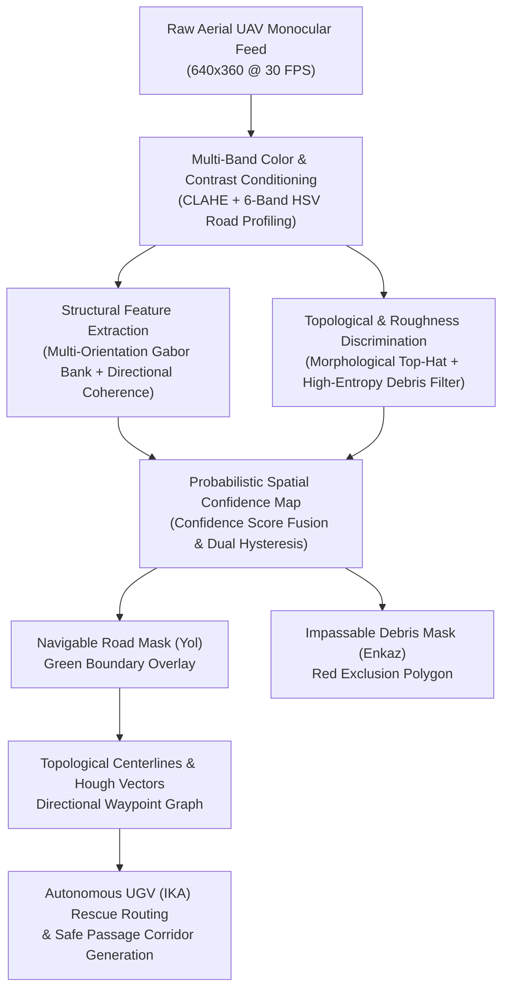

---

## 16-Stage Deterministic Vision Pipeline

Rather than relying on black-box neural networks that struggle with out-of-distribution disaster rubble, **UAV-Pathfinder** uses a deterministic 16-stage computer vision pipeline designed for mathematical interpretability, high edge throughput, and robustness against dust, shadows, and fragmented asphalt:

| 16-Stage Computer Vision Feature Extraction Pipeline |
|:---:|
| 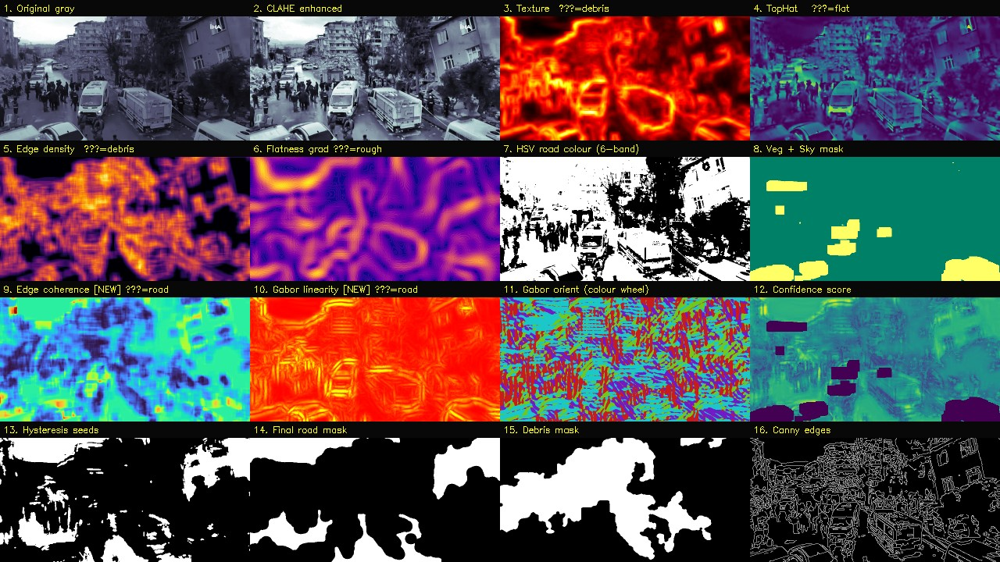 |
| *Visual breakdown of the 16 parallel and sequential filter outputs executed on an aerial disaster survey frame.* |

### Pipeline Stage Breakdown:

1. **Original Grayscale Conversion:** Normalizes raw dynamic range across varied sensor exposure.
2. **CLAHE Enhancement:** Contrast Limited Adaptive Histogram Equalization recovers road boundary detail under harsh glare and shadows.
3. **Texture Gradient Estimation:** Quantifies high-entropy micro-textures characteristic of broken concrete and shattered masonry.
4. **Morphological Top-Hat Filter:** Extracts locally uniform, flat road surfaces from surrounding structural rubble.
5. **Canny Edge Density Mapping:** Identifies chaotic high-frequency structural collapse vs. continuous road asphalt.
6. **Flatness Gradient:** Differentiates smooth drivable pavement from high-roughness obstacle surfaces.
7. **6-Band HSV Road Spectral Filtering:** Adaptively segments asphalt and compacted dirt roads across 6 color sub-bands.
8. **Vegetation & Sky Masking:** Excludes non-traversable foliage, tree canopies, and horizon artifacts.
9. **Directional Edge Coherence:** Highlights continuous, aligned road shoulders and curb lines.
10. **Gabor Linearity Bank:** Multi-scale spatial frequency filtering identifying linear road patterns.
11. **Gabor Orientation Map:** Polar color wheel projection encoding local surface orientation vectors.
12. **Fused Probabilistic Confidence Map:** Weighted linear combination of texture, color, and geometric confidence metrics.
13. **Dual-Threshold Hysteresis Seeds:** Propagates connectivity seeds outward from high-certainty road centers.
14. **Final Road Mask (`Yol`):** Morphologically closed polygon representing safe navigable road space.
15. **Debris Exclusion Mask (`Enkaz`):** Segmented structural collapse areas flagged with keep-out boundaries.
16. **Topological Centerline & Hough Vectors:** Skeletonized travel axes providing waypoint graphs for autonomous ground vehicles.

---

## Aerial Disaster Demonstration Gallery

### 1. Urban Earthquake Ruin Segmentation (Hatay / Antakya)

Aerial survey over heavily destroyed city blocks in Antakya (07.02.2023). The system isolates passable arterial corridors (`ROAD #1 29378px`, `ROAD #2 17230px`) from massive collapsed residential zones (`DEBRIS 63326px` to `89110px`), updating a persistent spatial SmartMap.

| Aerial Survey Animation | Segmented Road & Debris Analysis |
|:---:|:---:|
| 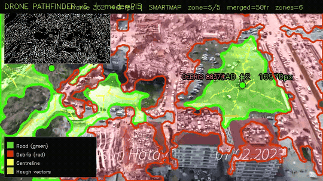 | 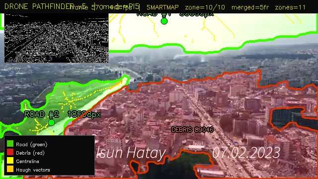 |
| **Real-Time Aerial Segmentation:** Processing low-altitude footage over earthquake ruins; separates arterial roadways (green) from collapsed buildings (red) with real-time Canny PIP inset. | **Topological SmartMap Output:** Frame telemetry showing 12 active spatial zones, road centerline derivation, and debris boundary containment. |

| Antakya Multi-Block Dense Debris Field | Hatay Downtown Commercial District Corridor |
|:---:|:---:|
| 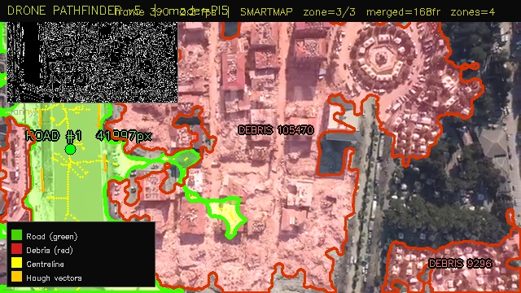 | 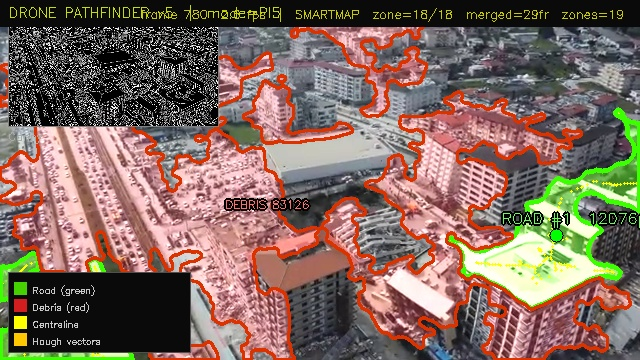 |
| **Multi-Block Zone Analysis:** 41,097 px road corridor isolated alongside 105,470 px structural collapse field with Canny PIP inset. | **Dense Downtown Arterial:** Real-time extraction of surviving thoroughfare ribbon adjacent to 83,126 px flattened structural ruin. |

---

### 2. Low-Altitude Rubble & Debris Delineation (Elbistan & Regional Collapses)

Low-altitude UAV flight over structural wreckage in Elbistan. Demonstrates fine-grained multi-segment road tracking (`ROAD #1`, `#2`, `#3`) through narrow gaps between collapsed structures.

| Ruin Navigation Animation | Multi-Segment Corridor Extraction |
|:---:|:---:|
| 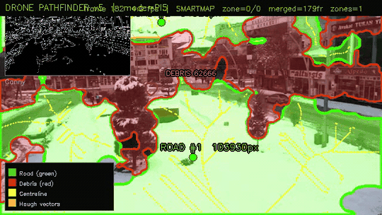 | 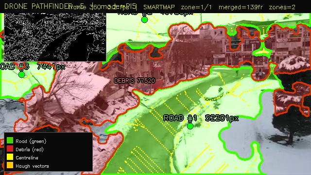 |
| **Narrow Corridor Detection:** Real-time adaptation to partially blocked roadways and rubble spills at low altitudes. | **Debris Margin Classification:** Accurate identification of 36,545 px and 21,500 px rubble obstructions encroaching into travel paths. |

| Narrow Blockade Winding Path Delineation | High-Density Residential Obstruction Analysis |
|:---:|:---:|
| 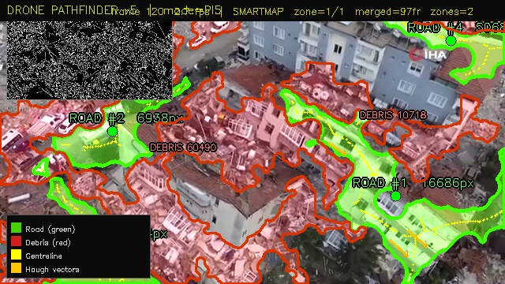 |  |
| **Passage Routing:** Dual-corridor segmentation (`ROAD #1 16686px`, `ROAD #2 6938px`) threading between massive 60,490 px collapsed concrete piles. | **Obstacle Margin Extraction:** Yellow centerline waypoints tracking traversable asphalt gaps directly beneath building overhangs. |

---

### 3. Emergency Rescue Vehicle Access Corridor & Wide-Area Survey

Aerial guidance for emergency ground responders and rapid damage triage. The pipeline identifies clear corridors directly through disaster-stricken streets, ensuring ambulances, fire engines, and heavy rescue machinery avoid debris bottlenecks.

| Access Corridor Animation | Ground Team Waypoint Projection |
|:---:|:---:|
| 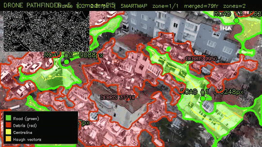 | 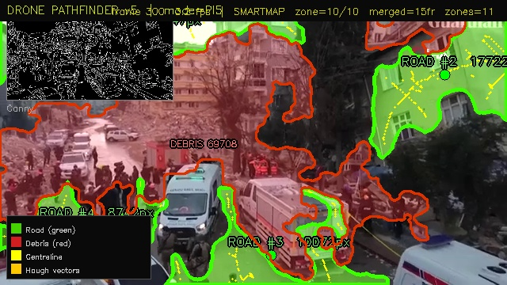 |
| **Real-Time Search & Rescue Guidance:** Tracking navigable road ribbons directly past active emergency vehicle convoys and personnel. | **Corridor Boundary Verification:** Green drivable boundaries alongside red debris zones with yellow travel centerlines. |

| Wide-Area Rubble Triage & Arterial Ribboning | Disaster Zone Arterial Overview |
|:---:|:---:|
| 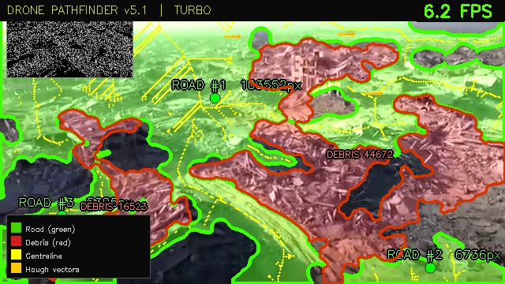 |  |
| **High-Altitude Triage:** Real-time high-throughput mode segmenting 103,552 px primary arterial road vs. 44,672 px rubble fields. | **Continuous Spatial Memory:** Recursive multi-frame accumulator preventing flicker across low-altitude wind turbulence. |

---

### 4. Macro-Orthomosaic Aerial Pathfinding & UGV (IKA) Autonomous Routing

End-to-end topological path planning across reconstructed disaster zones. The system processes an aerial orthomosaic map, identifies all rubble heaps (`Enkaz` with red X markers), and computes the optimal collision-free route (`IKA rotasi`) for an autonomous ground rescue rover to reach the designated target point.

| Autonomous UGV / IKA Navigation Animation | Complete Macro-Terrain Orthomosaic Map |
|:---:|:---:|
| 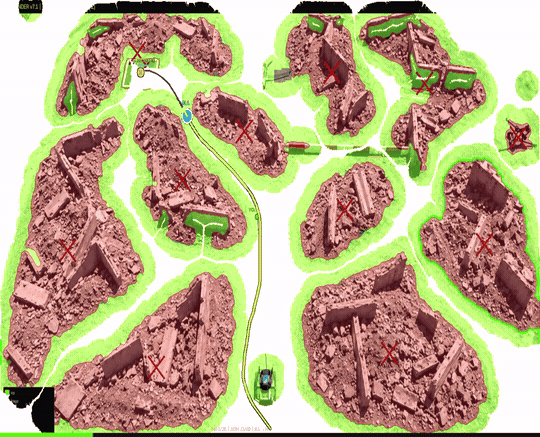 | 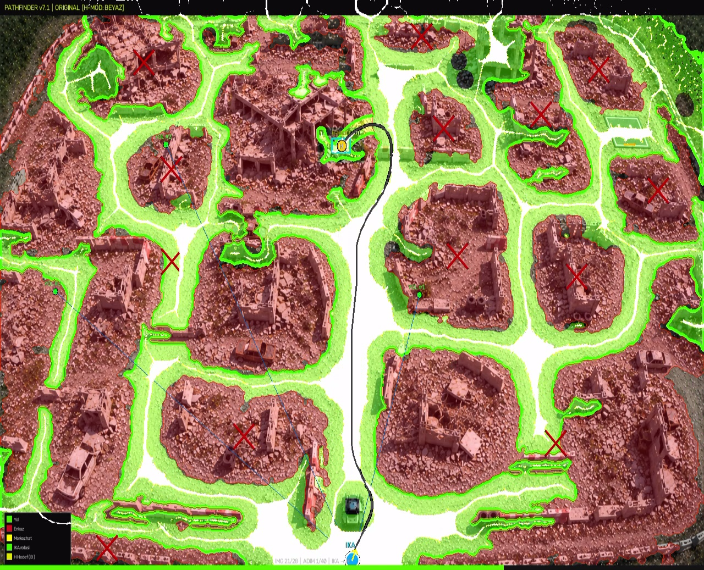 |
| **Autonomous Rover Dispatch:** Automated traversal animation showing the rover (`IKA`) executing the calculated trajectory past collapsed structures. | **Topological Grid Representation:** Pathfinder v7.1 global overview showing complete segmented road topology, debris zones, and target destination. |

| Multi-Compound Disaster Arena Trajectory Simulation | Urban Destruction Complex Global Routing |
|:---:|:---:|
| 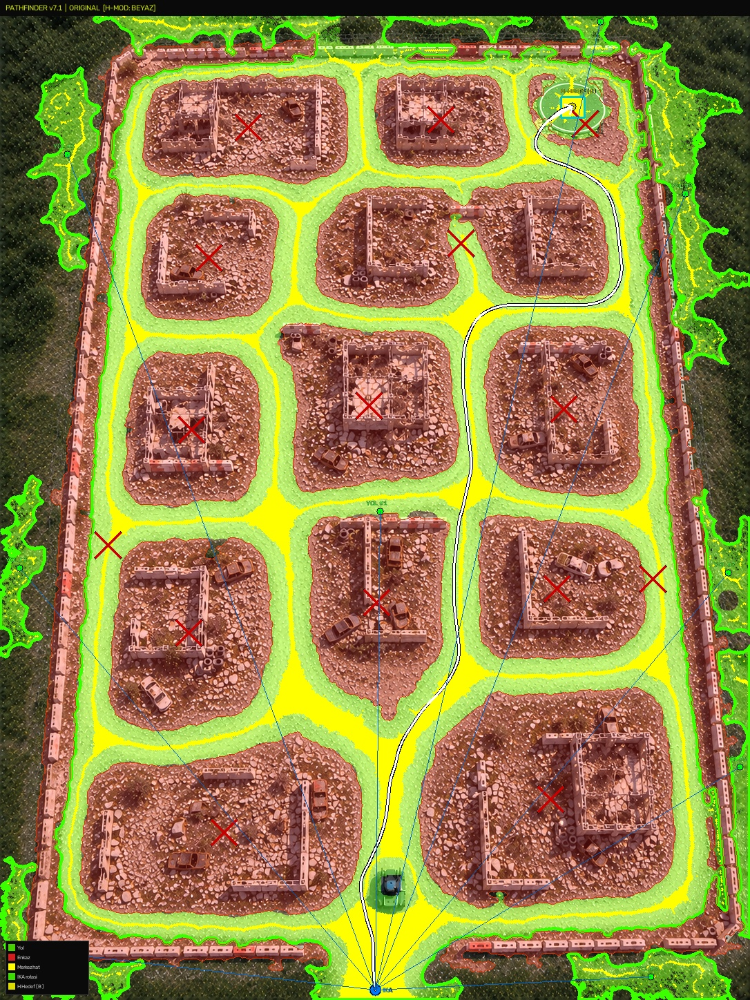 |  |
| **Structured Arena Benchmark:** Waypoint vector network threading through 10 distinct collapsed compounds with safe clearance buffers. | **Dense Urban Reconstruction:** Real-world rubble orthomosaic showing continuous traversability graph derivation. |

---

## Technical Specifications & Embedded Benchmarks

| Metric | Measured Specification |
| :--- | :--- |
| **Target Hardware** | Single-Board Computer (Raspberry Pi 5 / Cortex-A76 @ 2.4 GHz) |
| **Processing Modality** | Monocular Aerial UAV Video Stream (RGB) |
| **Input Resolution** | $640 \times 360$ pixels ($230,400\text{ px}$) |
| **Inference Latency** | **$0.31\,\text{s}$ per frame** (Standard Mode) / **$12.1\text{ FPS}$** (TURBO / Ultralight Mode) |
| **Feature Extraction** | Gabor Filter Bank ($N=4$ orientations, $k=31$, $\lambda=20\text{px}$), $21\times 21$ Coherence, Top-Hat |
| **Spatial Memory (SmartMap)** | Multi-frame temporal zone integration ($5\text{ to }77\text{ frames}$ recursive accumulation) |
| **Autonomous Routing** | Topological graph centerline extraction + collision-free UGV / IKA trajectory generation |
| **Safety Certification** | Zero-heuristic hard-margin obstacle exclusion (`Enkaz` buffer zone) |

---

## License

Distributed under the **MIT License**. All demonstration assets and documentation are openly available for research and educational purposes in post-disaster robotics and computer vision.
